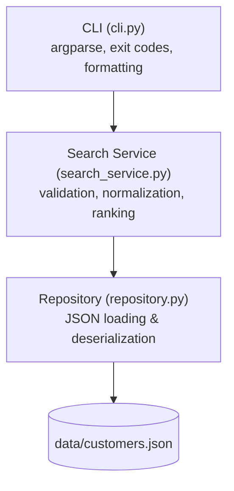

# Architecture

## Overview
A lightweight, modular command-line architecture designed for customer search. It organizes functionality into a layered separation of concerns (CLI presentation, search domain service, and JSON repository).



## Components
- **CLI (`cli.py` / Presentation Layer)**: Manages terminal arguments, formats output, renders error messages, and returns exit codes.
- **Search Service (`search_service.py` / Domain Layer)**: Encapsulates query validation, Unicode normalization, multi-field matching, relevance scoring, deterministic tie-breaking, and result capping.
- **Repository (`repository.py` / Data Access Layer)**: Manages file I/O and deserialization of `customers.json` into domain entities.
- **Domain Model (`models.py`)**: Defines the `Customer` entity (`id`, `first_name`, `last_name`, `email`, and computed `full_name`).

## Responsibilities
- **CLI**:
  - Parses command-line arguments using `argparse`.
  - Formats matching records (`id`, `first_name`, `last_name`, `email`) for standard output display.
  - Renders empty-state and error messages.
  - Maps service outcomes and validation exceptions to standard exit codes (`0` for success / zero matches, `2` for validation errors).
- **Search Service**:
  - Validates search query constraints (minimum length and allowed character whitelist).
  - Normalizes text (case-folding and diacritics stripping via Unicode NFD).
  - Evaluates search candidates against normalized query terms across targeted fields.
  - Categorizes match tiers (exact vs. partial) and applies deterministic ordering (tier, `last_name`, `first_name`, `id`).
  - Truncates final output to top 20 records.
- **Repository**:
  - Reads and deserializes `customers.json` from the local filesystem.
  - Maps JSON structures to `Customer` domain models.
  - Handles missing or unreadable file errors.

## Data Flow
1. User invokes the search command via CLI with a search term argument.
2. CLI delegates the query to `CustomerSearchService.search(query)`.
3. `CustomerSearchService` validates input length and character whitelist; raises a validation error if invalid.
4. `CustomerSearchService` retrieves customer records from `CustomerRepository.load_customers()`.
5. `CustomerSearchService` normalizes the query and customer fields, filters matches, ranks exact over partial matches, resolves ties, and caps results at 20.
6. `CustomerSearchService` returns ranked `list[Customer]` to CLI.
7. CLI formats and prints customer records (or zero-matches message) to stdout and exits with code `0`. If a validation error is encountered, CLI formats the error to stderr and exits with code `2`.

## Interfaces
```python
from dataclasses import dataclass
from typing import Protocol

@dataclass(frozen=True)
class Customer:
    id: str
    first_name: str
    last_name: str
    email: str

    @property
    def full_name(self) -> str:
        return f"{self.first_name} {self.last_name}"

class ValidationError(Exception):
    """Raised when input violates VR-01 or VR-02."""
    pass

class CustomerRepositoryInterface(Protocol):
    def load_customers(self) -> list[Customer]:
        ...

class CustomerSearchService:
    def __init__(self, repository: CustomerRepositoryInterface) -> None:
        ...

    def search(self, query: str) -> list[Customer]:
        ...

    def validate_query(self, query: str) -> None:
        ...

    def normalize(self, text: str) -> str:
        ...

class CLI:
    def run(self, argv: list[str]) -> int:
        ...
```

## Error Handling
- **Validation Exceptions**: Input validation failures (query length or disallowed characters) are raised by `CustomerSearchService` as domain validation exceptions.
- **CLI Exit Codes & Presentation**: CLI catches validation exceptions, prints the corresponding error message to stderr, and exits with code `2`.
- **Zero Matches State**: Returning zero matches is a valid query result (empty list), not an exception; CLI renders the friendly message to stdout with exit code `0`.
- **I/O & Persistence Failures**: Repository errors (missing file or malformed JSON) are caught and reported to stderr with an appropriate non-zero exit code.

## Testing Strategy
- **Unit Tests (`tests/test_search_service.py`)**:
  - Query validation rules (length checks and whitelist enforcement).
  - Unicode normalization (case insensitivity and diacritic removal).
  - Ranking hierarchy (exact matches preceding partial matches, tie-breaking order).
  - Output capping (maximum 20 records).
  - Mocked repository for fast, deterministic in-memory execution.
- **Persistence Tests (`tests/test_repository.py`)**:
  - Deserialization of valid `customers.json` datasets.
  - Error handling for missing or unreadable files.
- **CLI & Integration Tests (`tests/test_cli.py`)**:
  - End-to-end command execution and process exit codes (`0` and `2`).
  - Terminal output formatting for successful matches, empty state, and validation errors.
- **Performance Verification**:
  - Verification that search execution finishes well within 300 ms on a 1,000-record dataset.

## Dependencies
- Python 3.11+ standard library,
- `pytest` for test suite execution and verification.

## Design Decisions
- **Separation of Search Service from CLI**:
  - *Decision*: Keep search logic, validation, normalization, and ranking inside `CustomerSearchService`, keeping `CLI` focused on argument parsing and presentation.
  - *Reason*: Decouples presentation from business logic and allows direct, high-speed unit testing without CLI subprocess overhead.
- **Standard Library Unicode Normalization (NFD)**:
  - *Decision*: Use `unicodedata.normalize('NFD', ...)` to strip combining diacritical marks.
  - *Reason*: Meets the constraint of zero third-party runtime dependencies while reliably handling accented Latin characters.
- **In-Memory Search and Ranking**:
  - *Decision*: Load records into memory to perform linear scanning, filtering, and sorting.
  - *Reason*: Proportional to project scope; easily satisfies the 300 ms response time for 1,000 records without requiring external search index daemons.
- **Repository Pattern for Persistence**:
  - *Decision*: Encapsulate JSON file access behind a repository interface.
  - *Reason*: Shields search logic from storage mechanics and enables clean test fixture injection.

## Trade-offs
- **In-Memory Linear Scan vs. Database Indexing**:
  - *Trade-off*: Linear in-memory scanning avoids complex infrastructure and fits the single-user local scope, easily meeting the latency requirement for 1,000 records. However, it does not scale to large-scale datasets where indexed lookups would be required.
- **Standard Library `unicodedata` vs. External Transliteration Libraries**:
  - *Trade-off*: Avoids external dependencies and adheres to project constraints, but limits normalization strictly to Latin accented characters rather than arbitrary script transliteration.
- **In-Memory Result Capping vs. Pagination**:
  - *Trade-off*: Truncating to 20 records in-memory keeps the interface simple and satisfies the requirement, but defers cursor-based pagination for future scope.
